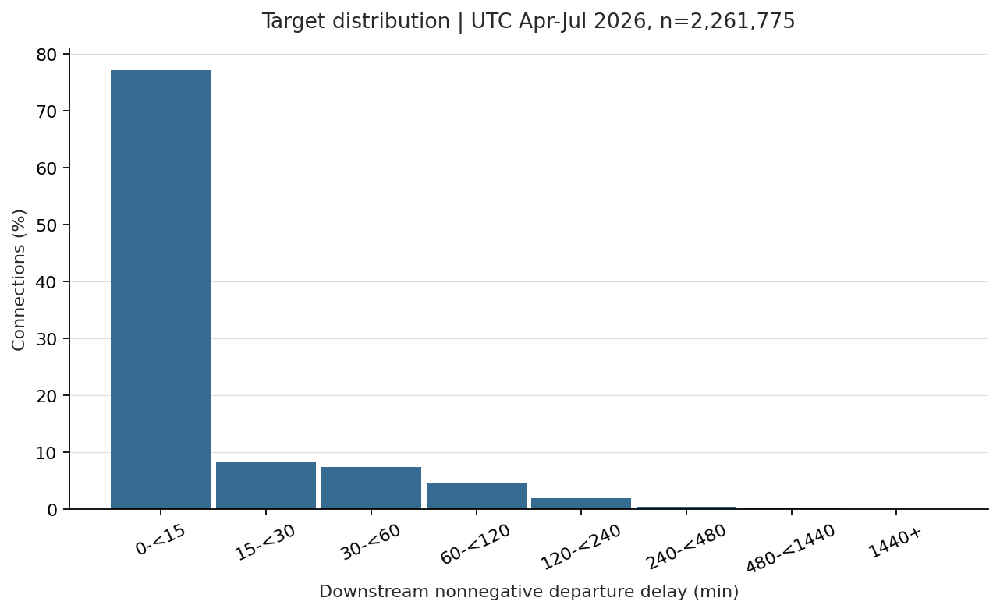
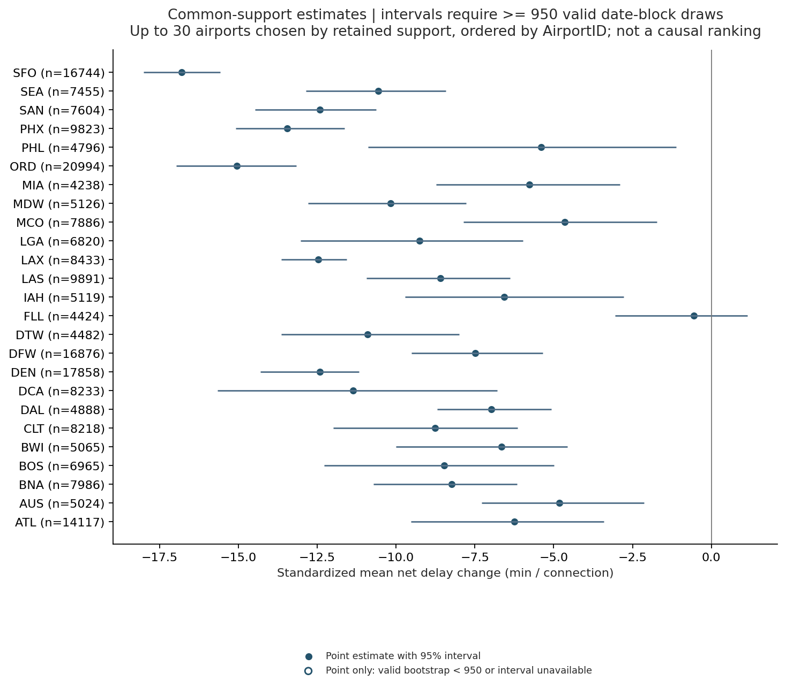
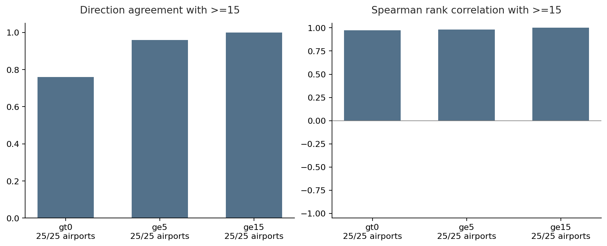
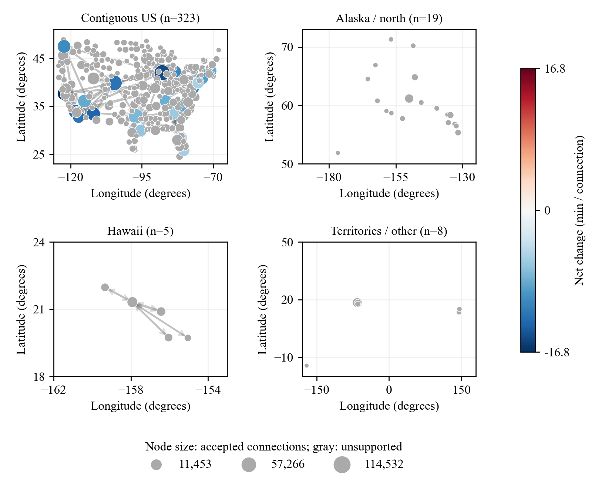
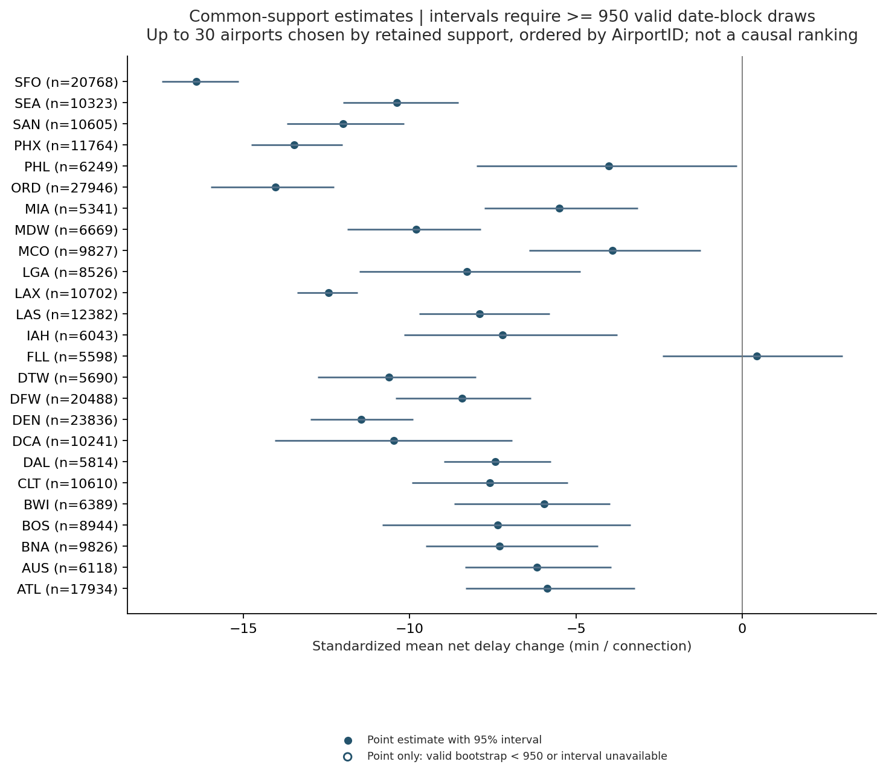
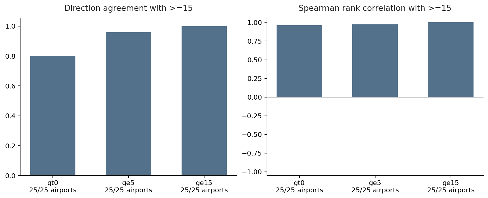
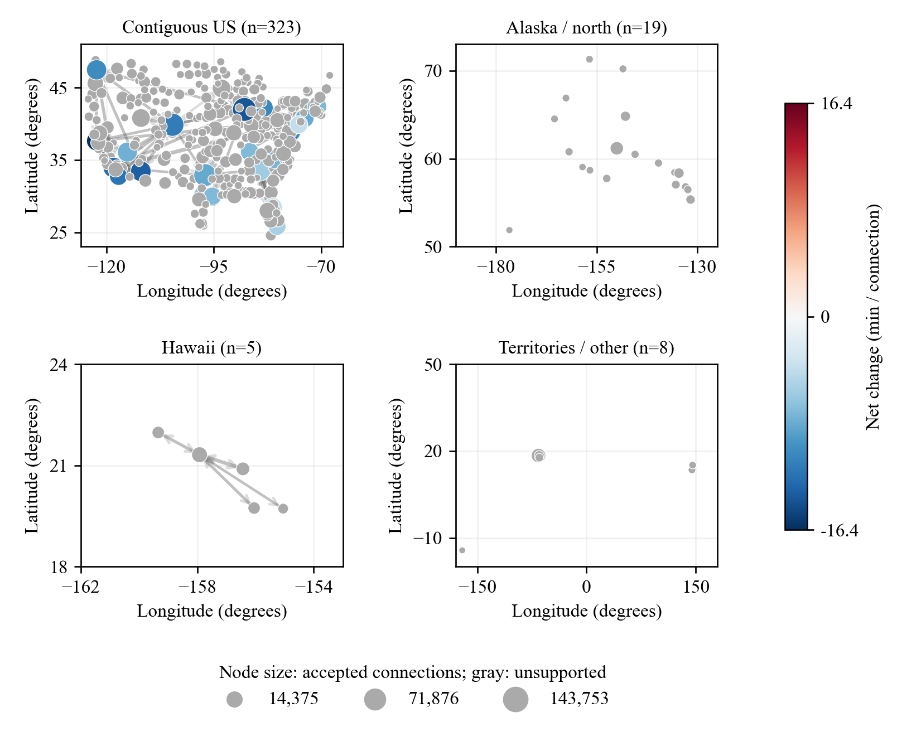

# Flight delay propagation and downstream prediction

## Research questions and principal findings

This study asks which airports absorb or amplify delay within consecutive same-aircraft connections (RQ1), and whether downstream nonnegative departure delay can be predicted at upstream actual arrival (RQ2). The analysis is descriptive and retrospective, conditional on valid observed completed connections. It does not allocate causal responsibility or answer the separate cause-code attribution question.

rf_d16_l50 had MAE 13.655 min and RMSE 42.917 min (n=560,077). [E0001]

## Related work and adopted methods

Li et al. (2024, pp. 4, 9–10) motivate distinguishing aircraft-chain propagation from airport-network summaries and auditing BTS/NOAA sources. Their distinction between minimum operational turnaround and buffer prevents treating scheduled turnaround as an observed buffer here. Chauhan et al. (2023, pp. 1–3) distinguish schedule connections and historical delay networks; this project adopts separate encodings for route traffic and airport connection outcomes, without implementing their percolation analysis. The UC Berkeley (2025) project motivates temporal validation, staged information experiments and severe-delay diagnosis. Its two-hours-before-departure horizon differs from upstream actual arrival, so its feature availability and performance figures are not transferred to this sample.

## Data, preparation and exploratory analysis

The project covers BTS Reporting US domestic flights from April through August 2026. Raw sources are preserved. Cleaning retains provenance and exclusion flags, handles local time zones, midnight and 2400, and forms candidates in same-tail scheduled order before checking endpoint continuity and observed timing. Cancelled, diverted, ambiguous and otherwise invalid chains define exclusions rather than zero outcomes. Month-prefix QA and future completed-connection selection mean the analysed population is conditional and is not a fully deployable arrival-time eligibility classifier. Aircraft family is the mainline representation, variant is an independent replacement, and the 2024/2025 B43 inventories are reference snapshots rather than historical fleet truth. Seats, aircraft age and airport infrastructure are excluded.

Single-flight EDA uses April–July local FlightDate, independently of the UTC connection windows. It includes 2,449,201 flights: 2,402,785 normally completed, 37,606 cancelled, 8,810 diverted and 0 with unknown operation status. Delay quantiles below describe normally completed flights only; cancellation and diversion are not zero-delay outcomes. [E0002]

Raw DepDelay and ArrDelay preserve negative early departures/arrivals; DepDelayMinutes and ArrDelayMinutes are the corresponding nonnegative measures. Their means can therefore differ even for the same flights. Each table row reports its own observed-outcome n; missing outcomes are excluded from its quantiles, not filled with zero.

Monthly single-flight delay distributions (all summary values in minutes).

| Month | Measure / evidence | n | Mean | q50 | q90 | q99 |
| --- | --- | ---: | ---: | ---: | ---: | ---: |
| 2026-04 | Departure raw [E0004] | 591,206 | 10.61 | -3.00 | 40.00 | 192.00 |
| 2026-04 | Arrival raw [E0005] | 591,206 | 4.78 | -7.00 | 39.00 | 192.00 |
| 2026-04 | Departure nonnegative [E0006] | 591,206 | 14.43 | 0.00 | 40.00 | 192.00 |
| 2026-04 | Arrival nonnegative [E0007] | 591,206 | 14.40 | 0.00 | 39.00 | 192.00 |
| 2026-05 | Departure raw [E0008] | 604,346 | 12.53 | -2.00 | 44.00 | 206.00 |
| 2026-05 | Arrival raw [E0009] | 604,346 | 6.22 | -7.00 | 43.00 | 204.00 |
| 2026-05 | Departure nonnegative [E0010] | 604,346 | 15.91 | 0.00 | 44.00 | 206.00 |
| 2026-05 | Arrival nonnegative [E0011] | 604,346 | 15.49 | 0.00 | 43.00 | 204.00 |
| 2026-06 | Departure raw [E0012] | 595,195 | 17.49 | -1.00 | 58.00 | 242.00 |
| 2026-06 | Arrival raw [E0013] | 595,195 | 11.68 | -5.00 | 58.00 | 241.00 |
| 2026-06 | Departure nonnegative [E0014] | 595,195 | 20.53 | 0.00 | 58.00 | 242.00 |
| 2026-06 | Arrival nonnegative [E0015] | 595,195 | 20.12 | 0.00 | 58.00 | 241.00 |
| 2026-07 | Departure raw [E0016] | 612,038 | 21.20 | 0.00 | 68.00 | 274.00 |
| 2026-07 | Arrival raw [E0017] | 612,038 | 15.60 | -3.00 | 67.00 | 272.00 |
| 2026-07 | Departure nonnegative [E0018] | 612,038 | 24.01 | 0.00 | 68.00 | 274.00 |
| 2026-07 | Arrival nonnegative [E0019] | 612,038 | 23.49 | 0.00 | 67.00 | 272.00 |

The 2024 B43 reference mapped an aircraft model for 2,166,791/2,449,201 flights (88.47%); 282,410 remained unmatched. [E0020]

The 2025 B43 reference mapped an aircraft model for 2,318,784/2,449,201 flights (94.68%); 130,417 remained unmatched. [E0021]

The 2024 inventory remains the primary reference; 2025 is a coverage sensitivity comparison and does not replace it. Mapping to a reference model is not proof of contemporaneous fleet membership, and unmatched tails/models remain explicit unknowns rather than being dropped.

Airport activity totals 4,898,402 arrival-plus-departure movements and 2,261,775 accepted same-aircraft connections; the QA-cohort eligibility flags count 2,261,775 main-analysis and 2,261,775 RQ2 connections. A flight contributes an origin movement and a destination movement, whereas a connection is a validated pair at its transfer airport. Connection activity here is grouped by QA cohort month, so it is not substituted for a UTC prediction-window model denominator. [E0022]

Development EDA contains 2,261,775 eligible connections, 355 airports and 6591 routes, including 437,491 overnight connections. RQ2 retains overnight and upstream-on-time connections; the RQ1 main sample is narrower. [E0070]

In 2026-04, n=554,684; mean/median downstream delay was 11.816/0.000 min, the 99th percentile was 154.000 min, and the severe-delay share was 0.051. [E0071]

In 2026-05, n=574,571; mean/median downstream delay was 13.209/0.000 min, the 99th percentile was 163.000 min, and the severe-delay share was 0.059. [E0072]

In 2026-06, n=561,972; mean/median downstream delay was 16.996/0.000 min, the 99th percentile was 198.000 min, and the severe-delay share was 0.080. [E0073]

In 2026-07, n=570,548; mean/median downstream delay was 19.679/0.000 min, the 99th percentile was 221.000 min, and the severe-delay share was 0.094. [E0074]

Development target distribution [E0075]

## Prediction timing, validation and new methods

Prediction time is upstream actual arrival; the target is downstream nonnegative departure delay, with prediction strictly before label time. May, June and July are forward validation months, trained respectively on mature April, April–May and April–June labels. UTC month-start half-open windows govern membership. All learned imputation, category encoding and scaling are fitted inside each training fold, and every prediction is clipped at zero. The August test follows a committed frozen choice and mature April–July refitting; test performance never selects a model. Development evaluation retains July predictions even when their labels mature in August. The feature as-of contract concerns inputs at each prediction time, separately from the retrospective completion date of model selection; it does not establish that selection had actually finished by 1 August.

The new methods are as-of availability matching, common-support standardization and paired UTC date-block uncertainty. METAR lacks actual receipt timestamps, so observation plus five minutes is assumed available, with observation age capped at 120 minutes. TAF uses the latest archive bulletin state available at prediction time and queries the later of scheduled departure and prediction time. Archive/issue timestamps are availability proxies, not verified historical delivery receipts; TEMPO, probability, amendment, cancellation and NIL states remain distinct. The registered conservative rule blocks unverified amended, corrected or delayed bulletin values without falling back to an older forecast. Thus locating a latest state does not imply an approved active forecast. NOAA is a separate retrospective supplement: exact quality-code whitelisting does not establish full official QC certification or contemporaneous delivery, and conflicting or structural missing values are not automatically filled. Weather absence retains the flight with explicit missingness rather than deleting it or imputing clear weather.

Development runs R0006, R0007, R0009, R0012, R0015, R0017, R0010, R0019, R0021, R0022, R0023, R0024, R0025 used 8 threads per fold and up to 3 simultaneous fold workers (a configured budget of 24 worker threads, not measured CPU utilization). [E0031] [E0032] [E0033] [E0034] [E0035] [E0036] [E0037] [E0038] [E0039] [E0040] [E0041] [E0042] [E0043] [E0044] [E0045] [E0046] [E0047] [E0048] [E0049] [E0050] [E0051] [E0052] [E0053] [E0054] [E0055] [E0056]

Development runs R0026 used 24 threads per fold and up to 1 simultaneous fold workers (a configured budget of 24 worker threads, not measured CPU utilization). [E0057] [E0058]

The freeze records an explicit execution-only change from 8 development threads per fold to 24 final threads, with learning parameters unchanged. [E0063]

The execution delta separately records prediction threads changing from 8 to 1, with learning parameters unchanged. [E0062] [E0063]

The final run recorded 24 threads for training and 1 for prediction, with 1 fold workers. Full reproduction must reuse this same freeze, including its 24 training threads and 1 prediction threads. Without an explicit prediction setting, prediction retains the recorded training budget. [E0059] [E0060] [E0061] [E0063]

The frozen shared prediction entry temporarily sets RF prediction workers to the sequential budget so trees accumulate in a fixed order, then restores the training n_jobs value before the joblib model is saved. Loading that model and calling bare predict does not preserve this prediction policy. The policy targets the original absolute 1e-10 contract for all reported metrics, including unnormalised error sums; it changes execution, not learning parameters. [E0063]

Elapsed time is not used to compare algorithm quality because execution budgets can differ. Parallel prediction reductions can differ in the last floating-point digits; the fixed full-reproduction acceptance tolerances remain atol=1e-10 and rtol=0, without relaxation.

## RQ1: airport absorption and amplification

For a connection, net change is downstream nonnegative departure delay minus upstream nonnegative arrival delay. A negative change means fewer delay minutes, not necessarily punctual departure. The main population is nonovernight with upstream delay at least 15 minutes. Airport comparison adjusts only for upstream-delay and scheduled-turnaround cells within frozen common support. Common airports, cells and reference weights are held fixed across months and final reporting; uncertainty uses common date blocks and is descriptive, not causal or multiplicity-adjusted. The April–August description includes the development months used to determine A/C/w. It describes an expanded period and is not an independent August validation.

The development reference required at least 1000 main-threshold connections and 30 prediction dates per eligible airport. Each common cell required at least 30 connections and 10 dates; every selected airport had to retain at least 50.0% of its threshold-specific population. Selection used covariates/counts, not net-delay outcomes. [E0023]

Attempt 1 used all eligible airports: 66 airports and 5 common master cells; minimum retained shares were gt0=0.2345, ge5=0.2246, ge15=0.2083. The all-threshold decision was fail. [E0024]

Attempt 2 used top 50 airports by main-threshold count: 50 airports and 5 common master cells; minimum retained shares were gt0=0.2861, ge5=0.2831, ge15=0.2611. The all-threshold decision was fail. [E0025]

Attempt 3 used top 25 airports by main-threshold count: 25 airports and 16 common master cells; minimum retained shares were gt0=0.7764, ge5=0.7950, ge15=0.8372. The all-threshold decision was pass. [E0026]

The frozen set A contains 25 airports: ORD (13930), DEN (11292), DFW (11298), SFO (14771), ATL (10397), PHX (14107), LAS (12889), LAX (12892), CLT (11057), MCO (13204), DCA (11278), BNA (10693), SEA (14747), SAN (14679), BOS (10721), LGA (12953), IAH (12266), BWI (10821), AUS (10423), MDW (13232), PHL (14100), DAL (11259), MIA (13303), DTW (11433), FLL (11697). C contains 16 master cells. The procedure stops at the first passing attempt; later fallback limits are not searched after success. [E0027] [E0028]

The 16 common master cells are distinct from the threshold-specific references: >0 uses 16 cells, >=5 uses 14, and >=15 uses 12. Threshold-specific weights condition one pooled development reference on its eligible cells; each weight column sums to one before display rounding. NA denotes a cell outside that threshold's reference, not a zero or an airport-specific renormalization. The >0 population excludes zero even in the [0,5) cell. These weights and A/C are reused for monthly and final RQ1, while an airport can lose support in an individual month. [E0027]

| Cell | Upstream delay (min) | Scheduled turnaround (min) | w: >0 | w: >=5 | w: >=15 |
| ---: | --- | --- | ---: | ---: | ---: |
| 0 | [0, 5) | [0, 45) | 0.032979 | NA | NA |
| 1 | [0, 5) | [45, 90) | 0.110100 | NA | NA |
| 4 | [5, 15) | [0, 45) | 0.058266 | 0.067995 | NA |
| 5 | [5, 15) | [45, 90) | 0.187023 | 0.218250 | NA |
| 8 | [15, 30) | [0, 45) | 0.047076 | 0.054936 | 0.076968 |
| 9 | [15, 30) | [45, 90) | 0.151249 | 0.176503 | 0.247287 |
| 10 | [15, 30) | [90, 180) | 0.024860 | 0.029011 | 0.040645 |
| 12 | [30, 60) | [0, 45) | 0.040361 | 0.047100 | 0.065990 |
| 13 | [30, 60) | [45, 90) | 0.127438 | 0.148717 | 0.208358 |
| 14 | [30, 60) | [90, 180) | 0.028881 | 0.033703 | 0.047219 |
| 16 | [60, 120) | [0, 45) | 0.022545 | 0.026310 | 0.036861 |
| 17 | [60, 120) | [45, 90) | 0.074728 | 0.087205 | 0.122178 |
| 18 | [60, 120) | [90, 180) | 0.027881 | 0.032536 | 0.045585 |
| 21 | [120, inf) | [45, 90) | 0.029523 | 0.034452 | 0.048269 |
| 22 | [120, inf) | [90, 180) | 0.013505 | 0.015760 | 0.022080 |
| 23 | [120, inf) | [180, 1440.000001) | 0.023584 | 0.027522 | 0.038559 |

For April–July development, the raw main population comprised 379,675 nonovernight connections with upstream delay at least 15 min. Its mean net change was -7.466 min per connection; cumulative increases, decreases and net change were 4,071,355, 6,906,103 and -2,834,748 sample-minutes. These totals depend on sample size and are distinct from airport means. [E0077]

The frozen common-support analysis supported 25 airports at the main threshold. The retained shares ranged from 0.837 to 0.970; standardized mean net changes ranged from -16.787 to -0.560 min per connection. Unsupported estimates remain missing and are not ranked. [E0078]

Retained common-support connections were 219,065/379,675 (57.698%) of the national raw main population, and 219,065/237,022 (92.424%) within the frozen 25-airport set. Individual supported-airport retention ranged from 83.72% to 96.97%; these denominators are not interchangeable. There were 25 negative and 0 positive point estimates; reportable intervals including zero: 1 (examples, estimate [95% interval]: FLL: -0.560 [-3.046, 1.141]). A point-estimate sign alone does not establish a stable airport ranking. [E0079] [E0080]

Direction agreement with the main threshold was gt0: 19/25, ge5: 24/25. Direction robustness is incomplete across these thresholds. [E0081]

AirportID 13930 had standardized net change -15.043 min (95% interval -16.968 to -13.160; retained n=20,994; 1000 valid bootstrap draws). [E0082]

AirportID 11292 had standardized net change -12.405 min (95% interval -14.298 to -11.173; retained n=17,858; 1000 valid bootstrap draws). [E0083]

AirportID 11298 had standardized net change -7.487 min (95% interval -9.503 to -5.339; retained n=16,876; 1000 valid bootstrap draws). [E0084]

At gt0, 25/25 frozen airports could be compared with the main threshold; direction agreement was 0.760 and Spearman correlation was 0.974. [E0085]

At ge5, 25/25 frozen airports could be compared with the main threshold; direction agreement was 0.960 and Spearman correlation was 0.981. [E0086]

At ge15, 25/25 frozen airports could be compared with the main threshold; direction agreement was 1.000 and Spearman correlation was 1.000. [E0087]

In 2026-04, 6 airports retained support under the same frozen reference; their standardized net changes ranged from -18.443 to -12.708 min. [E0088]

In 2026-05, 8 airports retained support under the same frozen reference; their standardized net changes ranged from -17.789 to -7.971 min. [E0089]

In 2026-06, 12 airports retained support under the same frozen reference; their standardized net changes ranged from -15.644 to -2.123 min. [E0090]

In 2026-07, 15 airports retained support under the same frozen reference; their standardized net changes ranged from -15.770 to 1.187 min. [E0091]

The set of supported airports can differ by month. These cross-airport ranges are not a fixed-airport time trend; a monthly comparison must identify the same supported airports, and unsupported months remain NA.

The network tables contain 355 airport nodes, 6600 directed routes and 2,445,202 BTS flights. Node size represents 2,261,775 accepted connections, node colour represents supported standardized mean change, and edge width represents flight volume. Gray nodes are unsupported; route counts are not propagated-delay counts. [E0092] [E0093]

Frozen common-support airport estimates and date-block uncertainty [E0094]

Direction and ranking sensitivity to upstream-delay thresholds [E0096]

Airport connection performance and directed flight flow. Report-display redraw from the archived node/edge tables; all coordinate-supported nodes are retained, without individual airport-code labels. Node size denotes accepted connections; colour denotes supported standardized net change (>=15 min), gray denotes unsupported estimates, and arrow width denotes BTS flight count. The global top 100 routes are selected before retaining within-panel arrows; Alaska longitudes wrap across the dateline. This coordinate overview is not causal attribution. [E0098] [E0099]

For April–August final description, the raw main population comprised 482,013 nonovernight connections with upstream delay at least 15 min. Its mean net change was -7.254 min per connection; cumulative increases, decreases and net change were 5,327,257, 8,823,718 and -3,496,461 sample-minutes. These totals depend on sample size and are distinct from airport means. [E0100]

The frozen common-support analysis supported 25 airports at the main threshold. The retained shares ranged from 0.842 to 0.969; standardized mean net changes ranged from -16.424 to 0.436 min per connection. Unsupported estimates remain missing and are not ranked. [E0101]

Retained common-support connections were 278,633/482,013 (57.806%) of the national raw main population, and 278,633/301,000 (92.569%) within the frozen 25-airport set. Individual supported-airport retention ranged from 84.16% to 96.85%; these denominators are not interchangeable. There were 24 negative and 1 positive point estimates; reportable intervals including zero: 1 (examples, estimate [95% interval]: FLL: 0.436 [-2.403, 3.012]). A point-estimate sign alone does not establish a stable airport ranking. [E0102] [E0103]

Direction agreement with the main threshold was gt0: 20/25, ge5: 24/25. Direction robustness is incomplete across these thresholds. [E0104]

AirportID 13930 had standardized net change -14.045 min (95% interval -15.986 to -12.278; retained n=27,946; 1000 valid bootstrap draws). [E0105]

AirportID 11292 had standardized net change -11.451 min (95% interval -12.982 to -9.905; retained n=23,836; 1000 valid bootstrap draws). [E0106]

AirportID 14771 had standardized net change -16.424 min (95% interval -17.457 to -15.139; retained n=20,768; 1000 valid bootstrap draws). [E0107]

At gt0, 25/25 frozen airports could be compared with the main threshold; direction agreement was 0.800 and Spearman correlation was 0.962. [E0108]

At ge5, 25/25 frozen airports could be compared with the main threshold; direction agreement was 0.960 and Spearman correlation was 0.972. [E0109]

At ge15, 25/25 frozen airports could be compared with the main threshold; direction agreement was 1.000 and Spearman correlation was 1.000. [E0110]

In 2026-04, 6 airports retained support under the same frozen reference; their standardized net changes ranged from -18.443 to -12.708 min. [E0111]

In 2026-05, 8 airports retained support under the same frozen reference; their standardized net changes ranged from -17.789 to -7.971 min. [E0112]

In 2026-06, 12 airports retained support under the same frozen reference; their standardized net changes ranged from -15.644 to -2.123 min. [E0113]

In 2026-07, 15 airports retained support under the same frozen reference; their standardized net changes ranged from -15.770 to 1.187 min. [E0114]

In 2026-08, 15 airports retained support under the same frozen reference; their standardized net changes ranged from -14.824 to 0.762 min. [E0115]

The set of supported airports can differ by month. These cross-airport ranges are not a fixed-airport time trend; a monthly comparison must identify the same supported airports, and unsupported months remain NA.

The network tables contain 355 airport nodes, 6629 directed routes and 3,054,489 BTS flights. Node size represents 2,821,852 accepted connections, node colour represents supported standardized mean change, and edge width represents flight volume. Gray nodes are unsupported; route counts are not propagated-delay counts. [E0116] [E0117]

Frozen common-support airport estimates and date-block uncertainty [E0118]

Direction and ranking sensitivity to upstream-delay thresholds [E0120]

Airport connection performance and directed flight flow. Report-display redraw from the archived node/edge tables; all coordinate-supported nodes are retained, without individual airport-code labels. Node size denotes accepted connections; colour denotes supported standardized net change (>=15 min), gray denotes unsupported estimates, and arrow width denotes BTS flight count. The global top 100 routes are selected before retaining within-panel arrows; Alaska longitudes wrap across the dateline. This coordinate overview is not causal attribution. [E0122] [E0123]

## RQ2: fixed-OLS feature development

training_mean had MAE 20.911 min and RMSE 50.930 min (n=1,707,091). [E0124]

training_median had MAE 16.618 min and RMSE 53.469 min (n=1,707,091). [E0125]

carry_forward had MAE 17.426 min and RMSE 57.331 min (n=1,707,091). [E0126]

The G0 stage used the fixed OLS estimator. g0_linear had MAE 19.574 min and RMSE 50.235 min (n=1,707,091). [E0127]

The G1 stage used the fixed OLS estimator. g1_linear had MAE 17.258 min and RMSE 46.941 min (n=1,707,091). [E0128]

Relative to R0006, R0007 MAE improved by 2.316 min (138.94 seconds). The signed candidate-minus-reference change was -2.316 min (95% date-block interval -2.406 to -2.216; n=1,707,091). Interval precision does not establish practical importance. [E0129]

The G2 stage used the fixed OLS estimator. g2_family_linear had MAE 17.249 min and RMSE 46.937 min (n=1,707,091). [E0130]

Relative to R0007, R0009 MAE improved by 0.009 min (0.56 seconds). The signed candidate-minus-reference change was -0.009 min (95% date-block interval -0.011 to -0.007; n=1,707,091). Interval precision does not establish practical importance. [E0131]

The G3 stage used the fixed OLS estimator. g3_linear had MAE 17.280 min and RMSE 46.903 min (n=1,707,091). [E0132]

Relative to R0009, R0012 MAE worsened by 0.031 min (1.85 seconds). The signed candidate-minus-reference change was 0.031 min (95% date-block interval 0.009 to 0.052; n=1,707,091). Interval precision does not establish practical importance. [E0133]

The G4A stage used the fixed OLS estimator. g4a_linear had MAE 17.214 min and RMSE 46.863 min (n=1,707,091). [E0134]

Relative to R0012, R0015 MAE improved by 0.066 min (3.95 seconds). The signed candidate-minus-reference change was -0.066 min (95% date-block interval -0.079 to -0.047; n=1,707,091). Interval precision does not establish practical importance. [E0135]

The G4B stage used the fixed OLS estimator. g4b_linear had MAE 16.807 min and RMSE 44.814 min (n=1,707,091). [E0136]

Relative to R0015, R0017 MAE improved by 0.407 min (24.43 seconds). The signed candidate-minus-reference change was -0.407 min (95% date-block interval -0.664 to -0.164; n=1,707,091). Interval precision does not establish practical importance. [E0137]

The sequence adds planned information, upstream and completed-tail history, family, recent airport operations and planned load, METAR, then TAF. Each adjacent comparison holds validation identities, targets and splits fixed. Incremental gains depend on this order and cannot be interpreted as intrinsic or causal variable importance.

## Independent aircraft and weather checks

Variant replaces family without becoming a cumulative mainline stage. g2_variant_linear had MAE 17.247 min and RMSE 46.934 min (n=1,707,091). [E0138]

Relative to R0009, R0010 MAE improved by 0.002 min (0.10 seconds). The signed candidate-minus-reference change was -0.002 min (95% date-block interval -0.003 to -0.000; n=1,707,091). Interval precision does not establish practical importance. [E0139]

NOAA supplements IEM in a separate branch and is ineligible for primary feature selection. g4b_noaa_linear had MAE 16.807 min and RMSE 44.814 min (n=1,707,091). [E0140]

Relative to R0017, R0019 MAE was unchanged. The signed candidate-minus-reference change was 0.000 min (95% date-block interval 0.000 to 0.000; n=1,707,091). Interval precision does not establish practical importance. [E0141]

The NOAA audit tracks 8 mapped quantities, of which 4 are in the actual METAR predictor whitelist: metar_wind_knots, metar_gust_knots, metar_visibility_miles, metar_ceiling_ft. It records 0 filled values in total and 0 fills in predictor columns; these are value-level counts rather than distinct-flight counts. Per-field counts were metar_temperature_f=0; metar_dewpoint_f=0; metar_wind_direction_deg=0; metar_relative_humidity=0; metar_wind_knots=0; metar_gust_knots=0; metar_visibility_miles=0; metar_ceiling_ft=0. [E0029]

With zero effective predictor backfills, this branch provides no effective NOAA input contrast. Unchanged errors reflect unchanged prediction inputs rather than evidence that otherwise usable NOAA information has no predictive value. The experiment is retained as a zero-treatment result under the registered conservative rules. [E0029]

Across 8 mapped fields, the exact-airport/time diagnostic contains zero accepted numeric value pairs. The no_numeric_overlap/no_exact_overlap labels indicate missing comparison support; they do not establish unit agreement. Conversions are documented operations, but agreement after conversion was not empirically verified by these archived pairs. [E0030]

The supplementary common source/prevailing-TAF availability subset contains 1,017,112 of 1,707,091 validation rows; the rule is metar_missing == 0 AND taf_prevailing_missing == 0; May-July UTC validation. It compares saved predictions without refitting; source availability does not imply complete per-variable weather. [E0142]

On this common subset, G3_to_G4a changed MAE by -0.096 min (95% interval -0.109 to -0.077; candidate minus reference). [E0143]

On this common subset, G4a_to_G4b changed MAE by -0.581 min (95% interval -0.807 to -0.360; candidate minus reference). [E0144]

On this common subset, G3_to_G4b changed MAE by -0.677 min (95% interval -0.896 to -0.459; candidate minus reference). [E0145]

R0015 recorded 2,261,775 weather queries; matched availability counts were metar_available: 2,247,194. Counts represent source states, not complete weather vectors. [E0146]

R0017 recorded 2,261,775 weather queries; matched availability counts were metar_available: 2,247,194; taf_available: 1,355,934; taf_prevailing_available: 1,355,934; taf_latest_state_located: 2,253,037. Counts represent source states, not complete weather vectors. [E0147]

R0019 recorded 2,261,775 weather queries; matched availability counts were metar_available: 2,247,194; taf_available: 1,355,934; taf_prevailing_available: 1,355,934; taf_latest_state_located: 2,253,037. Counts represent source states, not complete weather vectors. [E0148]

## Fixed-feature algorithms and frozen model selection

The development feature decision selected R0017: Minimum sample-weighted pooled May-July MAE; ties within 1e-9 prefer fewer predictors then earlier mainline stage. Variant and NOAA remained supplementary. [E0149]

For decision_tree, depth=8 and minimum leaf=50, dt_d8_l50 had MAE 12.544 min and RMSE 42.004 min (n=1,707,091). [E0150]

For decision_tree, depth=8 and minimum leaf=200, dt_d8_l200 had MAE 12.581 min and RMSE 42.181 min (n=1,707,091). [E0151]

For decision_tree, depth=16 and minimum leaf=200, dt_d16_l200 had MAE 12.485 min and RMSE 42.147 min (n=1,707,091). [E0152]

For decision_tree, depth=16 and minimum leaf=50, dt_d16_l50 had MAE 12.520 min and RMSE 42.124 min (n=1,707,091). [E0153]

For random_forest, depth=16 and minimum leaf=50, rf_d16_l50 had MAE 12.164 min and RMSE 41.765 min (n=1,707,091). [E0154]

For random_forest, depth=16 and minimum leaf=200, rf_d16_l200 had MAE 12.310 min and RMSE 42.110 min (n=1,707,091). [E0155]

The retained learned-model run was R0025; the frozen primary predictor was rf_d16_l50. The rule was: Registered family minima and sequential practical/monthly-stability promotion, followed by minimum pooled MAE against all three baselines. A training-mean, training-median or carry-forward baseline was permitted to win; there was no requirement to select a complex estimator. [E0156]

The practical and monthly-stability promotion rule was committed after P3 and before weather or tree/forest performance was inspected; it was not registered before P0. Feature selection is guided by OLS and depends on the fixed addition order; it does not establish the globally optimal tree feature set. The primary is the best of the rule-retained learned model and three baselines, which need not be the lowest-MAE estimator among every grid trial. Paired date-block intervals resample the existing predictions with shared date draws and recompute summed absolute or squared error divided by the corresponding sample count. They do not repeat training, feature selection or hyperparameter selection and are not selection-adjusted confidence intervals. [E0156]

The decision_tree challenger R0023 had pooled improvement 4.322 min, required improvement 0.100 min, and 3 improving months. Promotion was True; the recorded reasons were all promotion criteria passed. [E0156]

The random_forest challenger R0025 had pooled improvement 0.321 min, required improvement 0.100 min, and 3 improving months. Promotion was True; the recorded reasons were all promotion criteria passed. [E0156]

The retained learned model is explained separately from any winning baseline. Joint-group permutation preserves relationships within a feature group but can break relationships across groups; repeat standard deviation is not a confidence interval. Encoded linear coefficients use reference categories and scaled inputs, and airport–route overlap prevents independent airport-effect interpretation. Group permutation losses cannot be summed as factor contributions or substituted for feature-addition experiments. Their ratio cannot establish a multiple of TAF versus METAR incremental value, and small METAR sensitivity does not show that METAR is useless. PDP describes hypothetical input replacements and may cross correlated-feature support; neither technique establishes causation.

On the fixed 2026-07 validation explanation sample, the largest grouped permutation MAE increase was for G1_upstream_delay: 14.951 min (repeat SD 0.097, 5 repeats). This is model/sample sensitivity, not full-population temporal uncertainty. [E0157]

For coefficient interpretation, the OLS benchmark is the selected feature-source run R0017, independently of the retained algorithm. The saved development coefficient tables are read without refitting. [E0064] [E0065]

For the 2026-07 saved OLS fit, the prespecified numeric coefficients were upstream_arr_delay_minutes=36.805381 [E0066]; scheduled_turnaround_minutes=-135.209336 [E0067]; downstream_distance=-2.676602 [E0068]; the intercept was -7.128286 min. [E0069]

Under StandardScaler(with_mean=False), each listed coefficient is the change in the raw linear prediction, in minutes, for one unit of that transformed variable with other transformed inputs fixed: approximately one training standard deviation of the imputed original predictor. Constant predictors are an exception to this standard-deviation interpretation. Clipping predictions at zero means the deployed prediction need not have the same marginal change. The intercept describes transformed zero inputs and reference categories, which need not represent a feasible flight or population baseline. These conditional associations do not rank airport/route importance by absolute coefficient or identify causal effects. [E0065]

## One-time August assessment and remaining errors

The final metrics below come from the completed single-access ledger and saved-result verification. This report reads summary tables only and does not reopen test features or refit models.

rf_d16_l50 had MAE 13.655 min and RMSE 42.917 min (n=560,077). [E0158]

training_mean had MAE 23.630 min and RMSE 53.278 min (n=560,077). [E0159]

training_median had MAE 18.000 min and RMSE 56.178 min (n=560,077). [E0160]

carry_forward had MAE 19.107 min and RMSE 59.972 min (n=560,077). [E0161]

For the frozen primary predictor in ordinary_lt60, rf_d16_l50 had MAE 8.279 min and RMSE 10.816 min (n=510,752). [E0162]

For the frozen primary predictor in severe_ge60, rf_d16_l50 had MAE 69.325 min and RMSE 140.367 min (n=49,325). [E0163]

Relative to training_median, rf_d16_l50 reduced overall MAE by 24.14%, but the outcome-defined ordinary group (<60 min) had MAE 8.2788 versus 6.7446 min (worse; signed change +1.5342); its RMSE was 10.8156 versus 14.6415 min (better). In the severe group (>=60 min), MAE was 69.3255 versus 134.5447 min. Severe cases numbered 49,325/560,077 (8.8068%) and accounted for 44.7113% of primary absolute error and 94.2084% of primary squared error. Ordinary/severe changes in total absolute prediction error were +0.784/-3.217 million minutes (primary minus median). These are prediction errors, not actual flight-delay minutes saved. Groups are retrospective diagnostics, with no deployment switching rule or subgroup significance test. [E0164]

Relative to training_mean, primary-minus-baseline August MAE changed by -9.975 min (95% date-block interval -10.863 to -9.040). [E0165]

Relative to training_median, primary-minus-baseline August MAE changed by -4.345 min (95% date-block interval -6.647 to -1.985). [E0166]

Relative to carry_forward, primary-minus-baseline August MAE changed by -5.452 min (95% date-block interval -7.555 to -3.783). [E0167]

The 6 archived metric intervals are separate conditional intervals for the frozen models and 31 UTC test dates, not simultaneous 95% coverage of all comparisons. They do not cover retraining, reselection or performance in other months. [E0168] [E0169]

The primary predictor's mean/median signed error (prediction minus target) was -0.912/5.420 min; the 95th percentile absolute error was 39.020 min (n=560,077). [E0170]

Among the largest observed airport groups, 13930: rf_d16_l50 had MAE 14.839 min and RMSE 36.534 min (n=29,221). [E0171]

Among the largest observed airport groups, 11292: rf_d16_l50 had MAE 13.066 min and RMSE 41.332 min (n=26,103). [E0172]

Among the largest observed airline groups, WN: rf_d16_l50 had MAE 9.912 min and RMSE 21.569 min (n=111,242). [E0173]

Among the largest observed airline groups, DL: rf_d16_l50 had MAE 12.745 min and RMSE 37.224 min (n=86,557). [E0174]

Among the largest observed aircraft_family groups, Boeing 737 NG: rf_d16_l50 had MAE 12.521 min and RMSE 38.928 min (n=156,783). [E0175]

Among the largest observed aircraft_family groups, Airbus A320 family ceo: rf_d16_l50 had MAE 15.988 min and RMSE 49.729 min (n=89,666). [E0176]

Among the largest observed day_of_week groups, 7.0: rf_d16_l50 had MAE 14.778 min and RMSE 44.902 min (n=95,378). [E0177]

Among the largest observed day_of_week groups, 1.0: rf_d16_l50 had MAE 14.135 min and RMSE 43.487 min (n=91,625). [E0178]

Among the largest observed scheduled_hour groups, 7: rf_d16_l50 had MAE 11.101 min and RMSE 38.418 min (n=42,297). [E0179]

Among the largest observed scheduled_hour groups, 8: rf_d16_l50 had MAE 10.296 min and RMSE 39.455 min (n=39,530). [E0180]

Among the largest observed overnight groups, False: rf_d16_l50 had MAE 13.687 min and RMSE 41.607 min (n=445,048). [E0181]

Among the largest observed overnight groups, True: rf_d16_l50 had MAE 13.532 min and RMSE 47.647 min (n=115,029). [E0182]

## Research evolution, reproducibility and limitations

The development chain preserves unfavourable and favourable results rather than skipping a stage after observing its MAE. Failed and invalidated runs remain in the experiment index and research journal; their metrics are excluded from current conclusions.

R0001 was failed. Its recorded change was “Initial delivered synthetic preparation checks”; the decision was “Correct test assertion; preserve failure”. [E0183]

R0004 was invalidated. Its recorded change was “Isolate retrospective QA flags by prediction-month cutoff instead of the complete five-month archive”; the decision was “Boundary downstream planned-time ambiguity can be accepted; corrected by R0005 D0003”. [E0184]

R0011 was failed. Its recorded change was “Add historical airport departures and upcoming planned airport load to family mainline”; the decision was “Retain failure; fix under a new run_id”. [E0185]

R0013 was failed. Its recorded change was “Prepare immutable METAR, TAF bulletin states and GHCNh quality-controlled tables from local archives”; the decision was “Retain failure; fix under a new run_id”. [E0186]

Shared scripts implement preparation, feature generation, training, evaluation, standardization and selection; Chinese notebooks call these same functions and expose archived checks. Each run holds its actual JSON configuration, manifest, logs, metrics, evaluation identities, predictions and applicable models/figures/notebooks. This report's evidence index ties every numerical claim and displayed figure to its original run, CSV/JSON selector, SHA-256 receipt and journal heading. Raw and large local derived/model files remain necessary for full computational reproduction even when they are excluded from version control.

Limitations include one season and reporting coverage, conditional completed-connection selection, incomplete weather delivery provenance, retrospective NOAA supplementation, static aircraft inventories, and assumptions about advance availability of BTS planned schedules. Scheduled turnaround is not a measured operational buffer. Common support limits generalization and may disappear in individual months; missing intervals are not evidence of no effect. Date blocks quantify sampling uncertainty under the specified calendar, not causal identification or protection against all temporal dependence. Airport identity and route overlap, correlated weather and operating conditions prevent interpreting model coefficients, permutation/PDP patterns or airport rankings as responsibility. A final August result is one seasonal check, and any later method changes require a new unseen evaluation period.

## References

Li, C., Mao, J., Li, L., Wu, J., Zhang, L., Zhu, J., and Pan, Z. (2024). Flight delay propagation modeling: Data, Methods, and Future opportunities. Transportation Research Part E, 185, 103525. https://doi.org/10.1016/j.tre.2024.103525.

Chauhan, V. K., Ledwoch, A., Brintrup, A., Herrera, M., Giannikas, V., Stojkovic, G., and Mcfarlane, D. (2023). Network science approach for identifying disruptive elements of an airline. arXiv:2211.08140v2. https://arxiv.org/abs/2211.08140.

UC Berkeley School of Information (2025). Air Travel Delay Prediction: Feature Engineering and ML Approaches. https://www.ischool.berkeley.edu/projects/2025/air-travel-delay-prediction-feature-engineering-and-ml-approaches.
